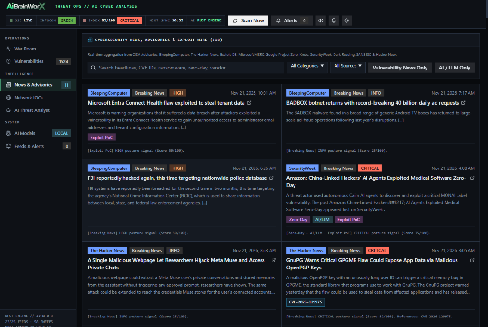
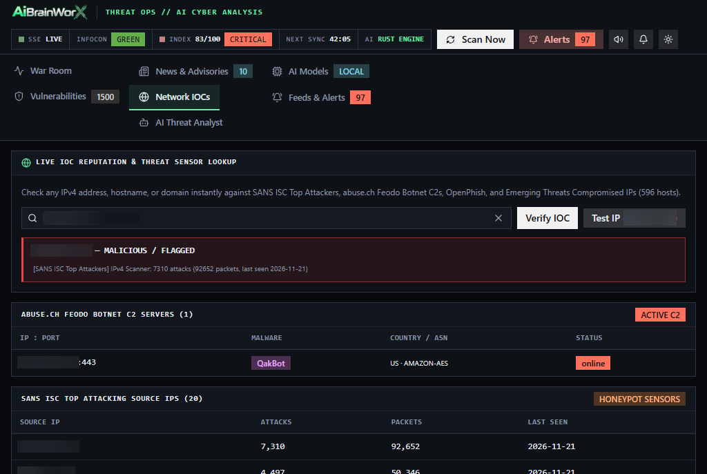
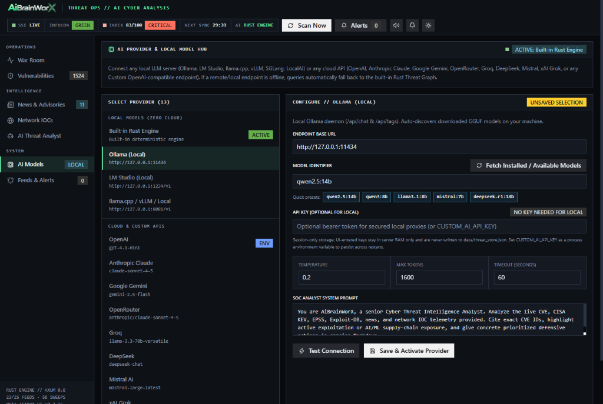
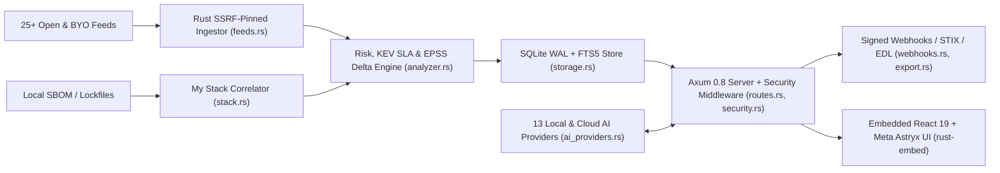

# AiBrainWorX — AI CyberSecurity Threat Analysis Board

[](https://www.youtube.com/watch?v=GVmWoFoDenw)
[-66efab?style=for-the-badge&logo=github)](https://aibrainworxdotcom.github.io/aibrainworx-ai-threat-board/)
[](https://github.com/AiBrainWorXdotCom/aibrainworx-ai-threat-board/actions/workflows/ci.yml)
[](LICENSE)

**An open-source (MIT), local-first, security-hardened SOC & threat-intelligence correlation dashboard packaged as a single executable binary (Rust + SQLite WAL + React 19).**

[](https://www.youtube.com/watch?v=GVmWoFoDenw)

> **▶ [Watch the v0.2.0 Launch Video & Live App Walkthrough on YouTube](https://www.youtube.com/watch?v=GVmWoFoDenw)**

---

## Introduction

AiBrainWorX CyberSecurity Threat Analysis Board was created in response to recent high-velocity cybersecurity headlines — widespread edge and perimeter zero-days, escalating ransomware campaigns, rapid CISA KEV additions, and an emerging wave of vulnerabilities targeting AI/LLM infrastructure (`PyTorch`, `LangChain`, `vLLM`, `LiteLLM`, `Gradio`, `Ray`, `MCP` servers, and unsafe model serialization). Security engineers, developers, and researchers often have to piece together fragmented advisories across NVD, KEV, EPSS, GitHub, Exploit-DB, IOC blocklists, and breaking security wires just to answer one question: *what matters right now, and how exposed is our stack?*

We built this board to consolidate those public intelligence streams into one crisp, zero-lock-in workspace that runs completely locally on **macOS, Linux, and Windows** — with a zero-dependency Rust risk-scoring and correlation engine out of the box, plus optional bring-your-own local LLM (`Ollama`, `LM Studio`, `llama.cpp`, `vLLM`) or cloud AI provider support. See the live dashboard, local SBOM correlator, deep AI triage, OPSEC Redact Mode, and IOC checker in action in the **[v0.2.0 YouTube launch video](https://www.youtube.com/watch?v=GVmWoFoDenw)**. It is released as **open source under the [MIT License](LICENSE)** so any team or defender can audit, extend, and self-host it freely.

---

## What It Is (and What It Is Not)

### What It Is
- **A Local Threat Intelligence Aggregator & Correlation Console:** Collects and normalizes public vulnerability feeds, exploit prediction scores (`EPSS`), `CISA KEV` active-exploitation mandates, AI/ML supply-chain advisories, network sensor telemetry, and security news wires in one place.
- **An Explainable Risk Prioritization & Triage Aid:** Computes transparent 0–100 composite risk scores, maps inferred MITRE ATT&CK tactics, tracks hourly Watchlist alerts via real-time Server-Sent Events (`SSE`), and supports on-demand AI-assisted triage using local or cloud models.
- **Cross-Platform & Single-User Workstation Friendly:** Compiles to a fast native Rust binary serving a React 19 + Meta Astryx UI frontend cleanly on **macOS, Linux, and Windows**.

### What It Is Not
- **Not an EDR, Firewall, SIEM, or Auto-Patcher:** It does not install agents on endpoints, inspect your internal packet traffic, block IPs automatically, or modify/patch software on hosts.
- **Not an Active Scanner or Exploitation Tool:** It does not port-scan targets, probe infrastructure, verify vulnerabilities against live hosts, or execute exploits.
- **Not a Public Multi-User SaaS App:** By default it binds strictly to `127.0.0.1`. Non-loopback bindings require an access token (`AUTH_TOKEN`) and should sit behind an HTTPS reverse proxy on shared networks.
- **Not Infallible Security Advice:** Heuristic scores and AI-generated summaries (especially LLM completions) can miss context or hallucinate details — always validate findings and remediation actions against primary vendor advisories (`NVD`, `CISA`, `GHSA`) before making production changes.

---

## Responsible Use & Legal Notice

- **Defensive & Authorized Research Only:** AiBrainWorX CyberSecurity Threat Analysis Board is intended strictly for defensive security monitoring, vulnerability triage, awareness, and authorized security research.
- **Respect Upstream Public Data Providers:** This dashboard aggregates volunteer and government-operated public feeds (CISA, NIST NVD, FIRST, SANS ISC, abuse.ch, OpenPhish, Emerging Threats, OSV, CIRCL, GitHub, and security news outlets). Avoid lowering the polling interval aggressively or running automated scraping loops against community endpoints; the default **1-hour (`3600s`)** sweep interval is designed to stay respectful of public rate limits.
- **Safe IOC Handling & OPSEC Mode:** Toggle **OPSEC** in the top command bar during screen-shares or streams to mask public attacker IPs and C2 targets (`198.51.xxx.xxx`). Phishing URLs display defanged (`hxxps://`, `[.]`) as non-clickable text.
- **No Warranty:** Provided `"AS IS"` under the [MIT License](LICENSE) without warranty of any kind. Users remain responsible for operational security decisions and compliance with applicable laws and organizational policies.

---

## Installation & Running (Single Binary, Docker, or Build From Source)

### Option A — Single-File Binary or Docker (Fastest)
Once built (or downloaded from **GitHub Releases**), `aibrainworx-threat-board` embeds the entire React UI (`rust-embed`) and embedded SQLite database — just copy one executable anywhere and run:

```bash
./aibrainworx-threat-board
# Optional flags:
#   --wallboard         Read-only kiosk display mode (403 on mutations)
#   --offline           Air-gapped mode (disables outbound feed sweeps; use Snapshot Import)
#   --bind <IP>         Bind interface (non-loopback auto-enables AUTH_TOKEN)
#   --port <PORT>       Listen port (default 8080)
#   --data-dir <PATH>   Custom SQLite database directory (default ./data)
```

Or run the multi-stage hardened container (`non-root`, `/data` volume, `HEALTHCHECK`):
```bash
docker build -t aibrainworx-threat-board .
docker run -d --name abw-board -p 127.0.0.1:8080:8080 -e AUTH_TOKEN="$(openssl rand -hex 24)" -v abw_data:/data aibrainworx-threat-board
```

### Option B — Build From Source (`macOS`, `Linux`, `Windows`)

#### Common Prerequisites
- **Git**
- **Rust toolchain** (`1.80+`, tested on `1.99`, via [rustup.rs](https://rustup.rs/))
- **Node.js `20+` & npm** (`React 19` + `Vite` build)

> Local inference (`Built-in Rust Engine`, `Ollama`, `LM Studio`, `llama.cpp`) and `--offline` mode work completely air-gapped with zero cloud API keys required.

#### macOS (Apple Silicon & Intel)

1. Install Xcode Command Line Tools, Node.js, and Rust:
   ```bash
   xcode-select --install || true
   brew install node
   curl --proto '=https' --tlsv1.2 -sSf https://sh.rustup.rs | sh
   source "$HOME/.cargo/env"
   ```
2. Clone and start the board:
   ```bash
   git clone https://github.com/AiBrainWorXdotCom/aibrainworx-ai-threat-board.git
   cd aibrainworx-ai-threat-board
   chmod +x start.sh
   ./start.sh
   ```
3. Open **http://127.0.0.1:8080** in your browser.

#### Linux (Ubuntu/Debian, Fedora/RHEL, Arch)

The Rust client and optional OS Keychain backend use OpenSSL and D-Bus Secret Service headers:

- **Ubuntu / Debian:**
  ```bash
  sudo apt-get update
  sudo apt-get install -y build-essential pkg-config libssl-dev libdbus-1-dev curl git
  ```
- **Fedora / RHEL / Rocky:**
  ```bash
  sudo dnf install -y gcc pkg-config openssl-devel dbus-devel curl git
  ```
- **Arch Linux:**
  ```bash
  sudo pacman -S --needed base-devel pkgconf openssl dbus curl git
  ```

Then install Rust & Node.js `20+` (`rustup`), clone, and launch:

```bash
curl --proto '=https' --tlsv1.2 -sSf https://sh.rustup.rs | sh
source "$HOME/.cargo/env"

git clone https://github.com/AiBrainWorXdotCom/aibrainworx-ai-threat-board.git
cd aibrainworx-ai-threat-board
chmod +x start.sh
./start.sh
```

Open **http://127.0.0.1:8080** in your browser.

#### Windows (PowerShell)

1. Ensure **Node.js `20+`**, **Rust** ([rustup.rs](https://rustup.rs/)), and **Visual Studio C++ Build Tools** (Desktop development with C++ workload) are installed.
2. Clone and start:
   ```powershell
   git clone https://github.com/AiBrainWorXdotCom/aibrainworx-ai-threat-board.git
   cd aibrainworx-ai-threat-board
   .\start.ps1
   ```
3. Open **http://127.0.0.1:8080** in your browser.

#### Custom Flags, Rebuilds & Manual Startup

- **Force a full rebuild** after pulling updates:
  - macOS / Linux: `./start.sh --rebuild`
  - Windows: `.\start.ps1 -Rebuild`
- **Forward runtime flags through launchers:** `./start.sh --wallboard`, `./start.sh --offline --port 9090`, `.\start.ps1 --offline --port 9090`
- **Manual build steps** (all platforms — remember to build `frontend` before `backend` so `rust-embed` bundles fresh assets):
  ```bash
  cd frontend && npm ci && npm run build && cd ..
  cd backend && cargo build --release && cd ..
  ```

---

## Features (v0.2.0)

1. **Open Public Cybersecurity Feeds + BYO Custom Feeds:**
   - **Vulnerability & Exploit Databases:** CISA KEV (with due-date SLA countdowns), NIST NVD CVE 2.0, GitHub Security Advisories, CIRCL Vulnerability Lookup, Google OSV.dev AI/ML Supply-Chain Watchlist, FIRST.org EPSS (plus **24h/7d delta & spike tracking**).
   - **Network & IOC Telemetry:** SANS ISC INFOCON, Top Attacked Ports, Top Attacking IPs, abuse.ch Feodo Botnet C2s, OpenPhish Phishing URLs (defanged), Emerging Threats Compromised IPs.
   - **Security News & Custom Feeds:** CISA Advisories/ICS, BleepingComputer, The Hacker News, Krebs on Security, SecurityWeek, Dark Reading, Exploit-DB PoCs, SANS ISC Diary, Google Project Zero, Microsoft MSRC, Hacker News Security Wire — plus per-feed enable/disable switches and **BYO Custom Feeds** (`RSS/Atom`, `IOC Text`, `STIX 2.1`, `MISP JSON`).

2. **My Stack — 100% Local SBOM & Lockfile Correlation:**
   - Drop or paste `CycloneDX`, `SPDX`, `package-lock.json`, `package.json`, `Cargo.lock`, `Cargo.toml`, `requirements.txt`, `pyproject.toml`, `go.mod`, or `pom.xml` plus custom vendor/product watchlists.
   - Everything parses strictly locally in Rust, flags exposed CVEs across KPIs, Overview alerts, Explorer filters, AI briefs, and webhooks without transmitting your dependency tree anywhere.

3. **SOC Workflow, Exports, Webhooks & Air-Gapped Sync:**
   - **Analyst Triage & Investigation:** Per-CVE status (`New`, `Investigating`, `Mitigated`, `False Positive`, `Accepted`), notes saved in SQLite WAL, FTS5 search, *What Changed & EPSS Surges* sweep diff panel.
   - **Enterprise Exports & Bulk IOC Triage:** Single-CVE Markdown/JSON/STIX 2.1 dossiers, formula-safe CSV & STIX 2.1 bundle exports, firewall blocklists (`EDL`, `nftables`, `pf`, `CSV`), SHA-256 verified secret-stripped offline snapshots, and up-to-200 batch IOC lookups with one-click defanged copy.
   - **Signed Outbound Webhooks:** SSRF-pinned HTTPS delivery to Slack, Discord, Microsoft Teams, or generic JSON endpoints with optional HMAC-SHA256 signatures and masked URL display.

4. **Universal AI Provider & Local Model Support (13 Providers):**
   - **Local Inference (Zero Cloud):** **Built-in Rust Engine**, **Ollama**, **LM Studio**, and **llama.cpp / vLLM / SGLang / LocalAI**.
   - **Cloud & Custom APIs:** **OpenAI**, **Anthropic Claude**, **Google Gemini**, **OpenRouter**, **Groq**, **DeepSeek**, **Mistral AI**, **xAI Grok**, and **Custom OpenAI-Compatible** endpoints — guarded by DNS-pinned SSRF checks, opt-in LAN endpoints, optional OS Keychain secret persistence, invisible-Unicode stripping, and Markdown XSS sanitization.

---

## Screenshots & Feature Walkthrough

### 1. SOC War Room Overview
Real-time command strip (`SSE Live`, `SANS INFOCON`, `AI Threat Index`, countdown timer), 6-metric telemetry grid, automated 7-day executive posture briefing, MITRE ATT&CK tactic breakdown, and prioritized remediation queue.


### 2. Multi-Feed Threat Analytics
Correlated 2x2 Recharts analytics tracking 7-day CVE/news/exploit velocity, CVSS vs. EPSS exploitation risk with CISA KEV highlights, SANS ISC live attacked ports, and most targeted vendors and OSS ecosystems.


### 3. Vulnerability Investigation Drawer & Deep AI Triage
Slide-over dossier panel inspecting CISA KEV mandates, CVSS/EPSS metrics, explainable AI risk factor weights, correlated news, and on-demand Markdown **Deep AI Triage** generated by your active local or cloud model.


### 4. Vulnerability Intelligence Explorer
Searchable, sortable CVE and OSV explorer filtering across `24h`, `7d`, `30d`, and all tracked items by severity, CISA KEV status, AI/ML stack impact, ransomware linkage, and public exploit availability.


### 5. Cybersecurity News, Advisories & Exploit Wire
Aggregated multi-source feed cards from CISA Advisories, BleepingComputer, The Hacker News, SecurityWeek, Dark Reading, Exploit-DB, and Hacker News with clickable extracted CVE chips and posture triage scores.



### 6. Network IOCs & Live Indicator Lookup
Instant IPv4, hostname, and phishing domain verifier cross-checking SANS ISC top attackers, abuse.ch Feodo botnet C2s, OpenPhish active campaigns, Emerging Threats compromised hosts, and FIRST.org top EPSS probabilities.



### 7. AI Threat Analyst Console
Interactive natural-language threat hunting console correlating live CVEs, CISA KEVs, exploit PoCs, and network sensors with clickable cited CVE drilldowns.


### 8. Universal AI Provider & Local Model Hub (13 Providers)
Unified configuration hub supporting local engines (Built-in Rust Engine, Ollama live discovery, LM Studio, llama.cpp/vLLM) and cloud APIs (OpenAI, Anthropic Claude, Google Gemini, OpenRouter, Groq, DeepSeek, Mistral, xAI, Custom OpenAI-Compatible) with connection testing and session-only API keys.



### 9. Real-Time Alerts, Hourly Watchdog & Feed Health Matrix
Configurable severity/keyword/KEV alerting rules, live SSE test simulation, acknowledge controls, and per-feed HTTP status, latency, and record telemetry across all 25 public sources.


---

## How It Was Made

AiBrainWorX AI Threat Board was engineered with a local-first, security-by-design architecture — compiling the React 19 UI directly into a single native executable powered by Axum 0.8 and embedded SQLite WAL/FTS5.



### Core Architecture & Stack
- **Pure Rust Backend (`backend/`):** Built with Rust (`edition 2021`), `axum 0.8`, `tokio`, `reqwest 0.12`, `rusqlite 0.32` (bundled SQLite WAL + FTS5), `rust-embed 8`, `keyring 3`, `sha2`/`hmac`, `feed-rs 2`, `serde`, and `tower-http 0.6`.
  - **Security & Keychain Layer (`backend/src/security.rs`):** DNS-pinned outbound SSRF validator (`validate_outbound_url` + IPv4-mapped IPv6 unwrapping + `Policy::none()`), invisible Unicode/bidi/Tag stripper, Markdown XSS/tracking-pixel sanitizer, CSPRNG token & constant-time compare helpers, and optional OS native Keychain integration.
  - **Embedded SQLite + FTS5 & Migration (`backend/src/storage.rs`):** Persists CVEs, triage states, 14-day EPSS history, and sweep delta snapshots in `data/threat_board.db` (`0600` Unix permissions) and auto-migrates legacy `data/threat_store.json`.
  - **Local SBOM Correlator (`backend/src/stack.rs`):** Auto-detects and parses 10 SBOM & lockfile formats offline and correlates them across live feeds.
  - **Webhooks & Exports (`backend/src/webhooks.rs`, `export.rs`):** HMAC-SHA256 signed Slack/Discord/Teams/Generic webhooks (masked URLs), STIX 2.1 bundles, EDL/`nftables`/`pf` blocklists, formula-safe CSVs, Markdown dossiers, and SHA-256 verified offline snapshots.
- **React 19 + Meta Astryx Frontend (`frontend/`):** Built with `React 19.1`, `TypeScript 5.8`, `Vite 6`, `@astryxdesign/core` (`0.7.16`), `Recharts 3`, and `lucide-react`, including client-side OPSEC redaction & Markdown sanitization (`utils/opsec.ts`) and an optional `VITE_DEMO_MODE=1` static synthetic demo build (`demoData.ts`).

---

## Security & API Key Hygiene

- **Localhost Only by Default:** Binds strictly to `127.0.0.1:8080`, validates `Host` and `Origin` headers against DNS rebinding and CSRF, and attaches strict CSP (`script-src 'self'; img-src 'self' data:; frame-ancestors 'none'`) headers. Binding to non-loopback addresses (`--bind 0.0.0.0`) automatically enforces `AUTH_TOKEN` authentication (`Bearer` or `HttpOnly; SameSite=Strict` cookie). See [SECURITY.md](SECURITY.md) for full details.
- **Recommended API Key Configuration (Environment Variables or OS Keychain):**
  Export your provider key in the shell before launching, OR optionally enable OS Keychain storage in **AI Models**:
  - Supported variables: `OPENAI_API_KEY`, `ANTHROPIC_API_KEY`, `GEMINI_API_KEY`, `OPENROUTER_API_KEY`, `GROQ_API_KEY`, `DEEPSEEK_API_KEY`, `MISTRAL_API_KEY`, `XAI_API_KEY`, `CUSTOM_AI_API_KEY`.
  - macOS / Linux (`bash` / `zsh`):
    ```bash
    export OPENAI_API_KEY="your-key-here"
    ./start.sh
    ```
  - Windows (`PowerShell`):
    ```powershell
    $env:OPENAI_API_KEY = "your-key-here"
    .\start.ps1
    ```
- **Session RAM Default:** Unless OS Keychain opt-in is checked, UI-entered keys stay **in memory only** (`#[serde(skip)]`) and are never serialized to `data/threat_board.db` or offline snapshots.
- **Zero-Key Local Models:** Install [Ollama](https://ollama.com/) (`ollama serve && ollama pull qwen2.5:14b`) or **LM Studio** locally, then select it inside **AI Models** — no cloud API key needed.

## License

Released as open source under the [MIT License](LICENSE).
