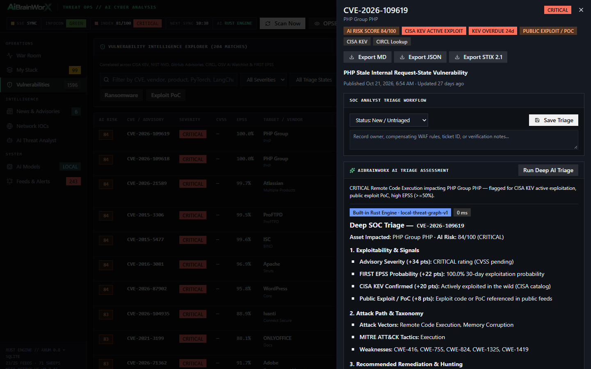
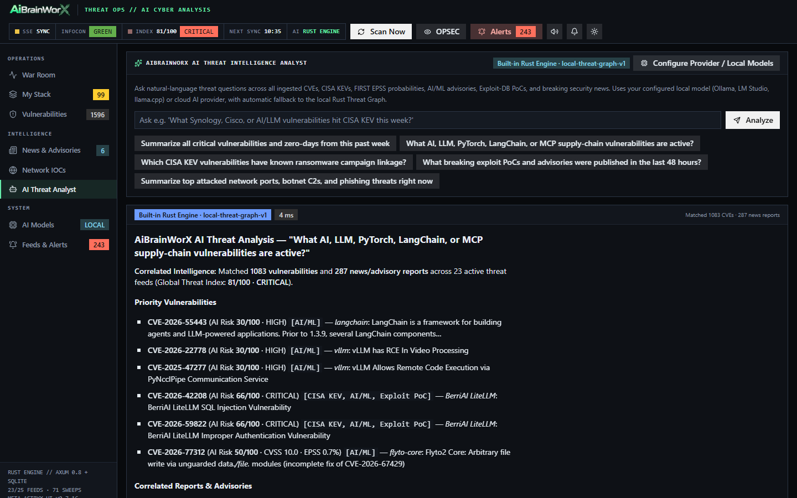
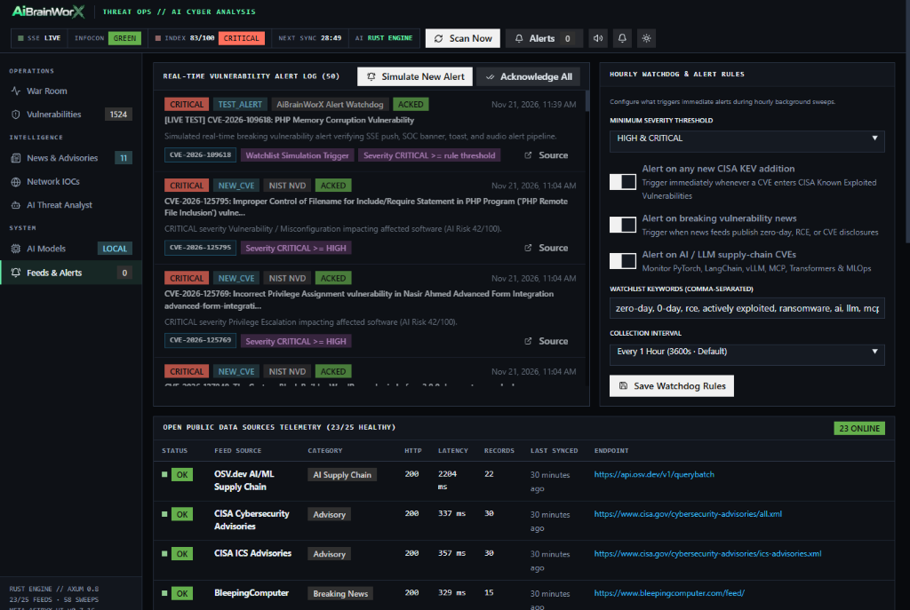
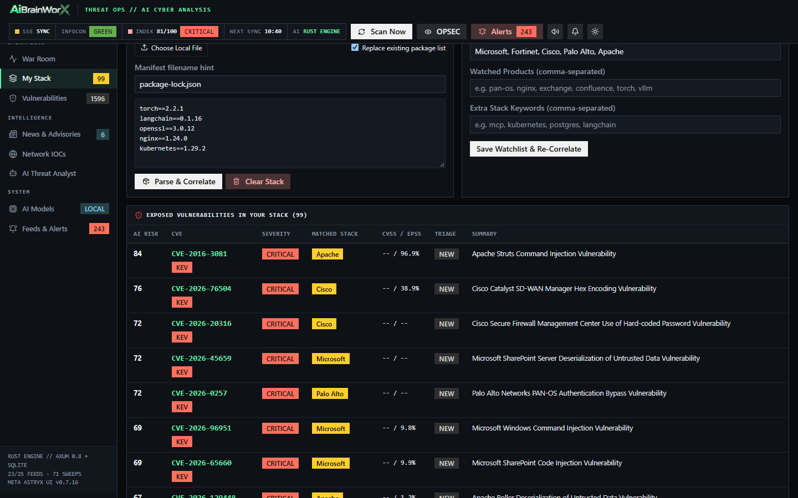
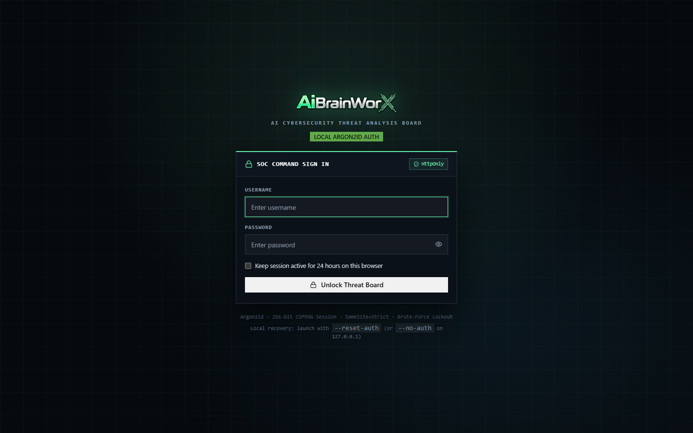
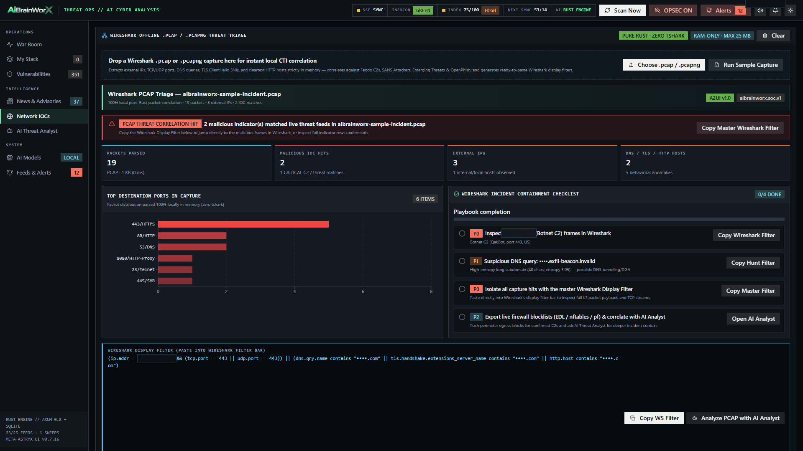
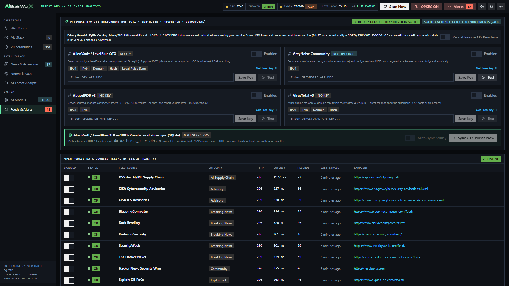
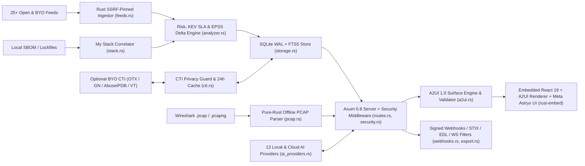

# AiBrainWorX — AI CyberSecurity Threat Analysis Board

[](https://youtu.be/RS_fvOk8440)
[-66efab?style=for-the-badge&logo=github)](https://aibrainworxdotcom.github.io/aibrainworx-ai-threat-board/)
[](https://github.com/AiBrainWorXdotCom/aibrainworx-ai-threat-board/actions/workflows/ci.yml)
[](LICENSE)

**An open-source (MIT), local-first, security-hardened SOC & threat-intelligence correlation dashboard packaged as a single executable binary (Rust + SQLite WAL + React 19).**

[](https://youtu.be/RS_fvOk8440)

> **▶ [Watch the Launch Video & Live App Walkthrough on YouTube](https://youtu.be/RS_fvOk8440)**

---

## Introduction

AiBrainWorX CyberSecurity Threat Analysis Board was created in response to recent high-velocity cybersecurity headlines — widespread edge and perimeter zero-days, escalating ransomware campaigns, rapid CISA KEV additions, and an emerging wave of vulnerabilities targeting AI/LLM infrastructure (`PyTorch`, `LangChain`, `vLLM`, `LiteLLM`, `Gradio`, `Ray`, `MCP` servers, and unsafe model serialization). Security engineers, developers, and researchers often have to piece together fragmented advisories across NVD, KEV, EPSS, GitHub, Exploit-DB, IOC blocklists, and breaking security wires just to answer one question: *what matters right now, and how exposed is our stack?*

We built this board to consolidate those public intelligence streams into one crisp, zero-lock-in workspace that runs completely locally on **macOS, Linux, and Windows** — with a zero-dependency Rust risk-scoring and correlation engine out of the box, plus optional bring-your-own local LLM (`Ollama`, `LM Studio`, `llama.cpp`, `vLLM`) or cloud AI provider support. See the live SOC War Room, A2UI 1.0 interactive surfaces, pure-Rust Wireshark PCAP triage, optional BYO CTI Enrichment Hub (OTX / GreyNoise / AbuseIPDB / VirusTotal + 24h SQLite cache), local SBOM correlator, and OPSEC Redact Mode in action in the **[v0.6.0 YouTube launch video](https://youtu.be/RS_fvOk8440)**. It is released as **open source under the [MIT License](LICENSE)** so any team or defender can audit, extend, and self-host it freely.

---

## What It Is (and What It Is Not)

### What It Is
- **A Local Threat Intelligence Aggregator & Correlation Console:** Collects and normalizes public vulnerability feeds, exploit prediction scores (`EPSS`), `CISA KEV` active-exploitation mandates, AI/ML supply-chain advisories, network sensor telemetry, and security news wires in one place.
- **An Explainable Risk Prioritization & Triage Aid:** Computes transparent 0–100 composite risk scores, maps inferred MITRE ATT&CK tactics, tracks hourly Watchlist alerts via real-time Server-Sent Events (`SSE`), and supports on-demand AI-assisted triage using local or cloud models.
- **Cross-Platform & Single-User Workstation Friendly:** Compiles to a fast native Rust binary serving a React 19 + Meta Astryx UI frontend cleanly on **macOS, Linux, and Windows**.

### What It Is Not
- **Not an EDR, Firewall, SIEM, or Auto-Patcher:** It does not install agents on endpoints, inspect your internal packet traffic, block IPs automatically, or modify/patch software on hosts.
- **Not an Active Scanner or Exploitation Tool:** It does not port-scan targets, probe infrastructure, verify vulnerabilities against live hosts, or execute exploits.
- **Not a Public Multi-User SaaS App:** By default it binds strictly to `127.0.0.1`. Non-loopback bindings require an access token (`AUTH_TOKEN`) and should sit behind an HTTPS reverse proxy on shared networks.
- **Not Infallible Security Advice:** Heuristic scores and AI-generated summaries (especially LLM completions) can miss context or hallucinate details — always validate findings and remediation actions against primary vendor advisories (`NVD`, `CISA`, `GHSA`) before making production changes.

---

## Responsible Use & Legal Notice

- **Defensive & Authorized Research Only:** AiBrainWorX CyberSecurity Threat Analysis Board is intended strictly for defensive security monitoring, vulnerability triage, awareness, and authorized security research.
- **Respect Upstream Public Data Providers:** This dashboard aggregates volunteer and government-operated public feeds (CISA, NIST NVD, FIRST, SANS ISC, abuse.ch, OpenPhish, Emerging Threats, OSV, CIRCL, GitHub, and security news outlets). Avoid lowering the polling interval aggressively or running automated scraping loops against community endpoints; the default **1-hour (`3600s`)** sweep interval is designed to stay respectful of public rate limits.
- **Safe IOC Handling & OPSEC Mode:** Toggle **OPSEC** in the top command bar during screen-shares or streams to mask public attacker IPs and C2 targets (`198.51.xxx.xxx`). Phishing URLs display defanged (`hxxps://`, `[.]`) as non-clickable text.
- **No Warranty:** Provided `"AS IS"` under the [MIT License](LICENSE) without warranty of any kind. Users remain responsible for operational security decisions and compliance with applicable laws and organizational policies.

---

## Installation & Running (Single Binary, Docker, or Build From Source)

### Option A — Single-File Binary or Docker (Fastest)
Once built (or downloaded from **GitHub Releases**), `aibrainworx-threat-board` embeds the entire React UI (`rust-embed`) and embedded SQLite database — just copy one executable anywhere and run:

```bash
./aibrainworx-threat-board
# Optional flags:
#   --wallboard              Read-only kiosk display mode (403 on mutations)
#   --offline                Air-gapped mode (disables outbound feed sweeps; use Snapshot Import)
#   --no-auth                Disable login screen on loopback 127.0.0.1 only (ignored on non-loopback)
#   --reset-auth             Clear local admin password & 2FA secrets to return to first-run setup
#   --allowed-hosts <CSV>    Explicit Host allowlist for wildcard --bind 0.0.0.0 / :: DNS-rebinding defense
#   --trust-proxy            Trust X-Forwarded-For / X-Forwarded-Proto from a reverse proxy (off by default)
#   --bind <IP>              Bind interface (non-loopback enforces authentication)
#   --port <PORT>            Listen port (default 8080)
#   --data-dir <PATH>        Custom SQLite database directory (default ./data)
```

Or run the multi-stage hardened container (`non-root`, `/data` volume, `HEALTHCHECK`):
```bash
docker build -t aibrainworx-threat-board .
docker run -d --name abw-board -p 127.0.0.1:8080:8080 -e AUTH_TOKEN="$(openssl rand -hex 24)" -v abw_data:/data aibrainworx-threat-board
```

### Option B — Build From Source (`macOS`, `Linux`, `Windows`)

#### Common Prerequisites
- **Git**
- **Rust toolchain** (`1.80+`, tested on `1.99`, via [rustup.rs](https://rustup.rs/))
- **Node.js `20+` & npm** (`React 19` + `Vite` build)

> Local inference (`Built-in Rust Engine`, `Ollama`, `LM Studio`, `llama.cpp`) and `--offline` mode work completely air-gapped with zero cloud API keys required.

#### macOS (Apple Silicon & Intel)

1. Install Xcode Command Line Tools, Node.js, and Rust:
   ```bash
   xcode-select --install || true
   brew install node
   curl --proto '=https' --tlsv1.2 -sSf https://sh.rustup.rs | sh
   source "$HOME/.cargo/env"
   ```
2. Clone and start the board:
   ```bash
   git clone https://github.com/AiBrainWorXdotCom/aibrainworx-ai-threat-board.git
   cd aibrainworx-ai-threat-board
   chmod +x start.sh
   ./start.sh
   ```
3. Open **http://127.0.0.1:8080** in your browser.

#### Linux (Ubuntu/Debian, Fedora/RHEL, Arch)

The Rust client and optional OS Keychain backend use OpenSSL and D-Bus Secret Service headers:

- **Ubuntu / Debian:**
  ```bash
  sudo apt-get update
  sudo apt-get install -y build-essential pkg-config libssl-dev libdbus-1-dev curl git
  ```
- **Fedora / RHEL / Rocky:**
  ```bash
  sudo dnf install -y gcc pkg-config openssl-devel dbus-devel curl git
  ```
- **Arch Linux:**
  ```bash
  sudo pacman -S --needed base-devel pkgconf openssl dbus curl git
  ```

Then install Rust & Node.js `20+` (`rustup`), clone, and launch:

```bash
curl --proto '=https' --tlsv1.2 -sSf https://sh.rustup.rs | sh
source "$HOME/.cargo/env"

git clone https://github.com/AiBrainWorXdotCom/aibrainworx-ai-threat-board.git
cd aibrainworx-ai-threat-board
chmod +x start.sh
./start.sh
```

Open **http://127.0.0.1:8080** in your browser.

#### Windows (PowerShell)

1. Ensure **Node.js `20+`**, **Rust** ([rustup.rs](https://rustup.rs/)), and **Visual Studio C++ Build Tools** (Desktop development with C++ workload) are installed.
2. Clone and start:
   ```powershell
   git clone https://github.com/AiBrainWorXdotCom/aibrainworx-ai-threat-board.git
   cd aibrainworx-ai-threat-board
   .\start.ps1
   ```
3. Open **http://127.0.0.1:8080** in your browser.

#### Custom Flags, Rebuilds & Manual Startup

- **Force a full rebuild** after pulling updates:
  - macOS / Linux: `./start.sh --rebuild`
  - Windows: `.\start.ps1 -Rebuild`
- **Forward runtime flags through launchers:** `./start.sh --wallboard`, `./start.sh --offline --port 9090`, `.\start.ps1 --offline --port 9090`
- **Manual build steps** (all platforms — remember to build `frontend` before `backend` so `rust-embed` bundles fresh assets):
  ```bash
  cd frontend && npm ci && npm run build && cd ..
  cd backend && cargo build --release && cd ..
  ```

---

## Features (v0.6.0)

1. **Optional BYO CTI Enrichment Hub, Private OTX Pulse Sync & 24h SQLite Cache (New in v0.6.0):**
   - **Opt-In On-Demand Indicator Enrichment:** Enrich suspicious public IPs, domains, and file hashes directly inside **Network IOCs** (including Wireshark PCAP hits, Top External Talkers, and Feodo C2s) against **AlienVault / LevelBlue OTX**, **GreyNoise Community** (works out of the box with no API key), **AbuseIPDB v2**, and **VirusTotal v3** — zero forced sign-ups.
   - **Hard Privacy Guard & Credential Isolation:** Automatically refuses to transmit RFC1918 private IPs, loopback/CGNAT/ULA addresses, or internal domains (`.local`, `.internal`, `.lan`, `.corp`, `.invalid`) to external CTI APIs. All provider API keys are marked `#[serde(skip)]` (RAM-only default or optional OS Keychain via `keyring` v3) and every request uses DNS-pinned, zero-redirect `https://`.
   - **Private Local OTX Pulse Sync & 24h SQLite Cache:** Syncs your subscribed OTX pulses into local SQLite (`otx_pulses`, capped at `15,000` indicators/pulse) to correlate IOC lookups and offline `.pcap`/`.pcapng` captures locally, while caching enrichment verdicts in local SQLite for 24 hours (`SQLITE CACHED (24H)` + `Force Refresh` + `Clear Cache`) to protect free API quotas.

2. **Wireshark Offline `.pcap` / `.pcapng` Threat Triage & Display Filters (v0.5.0):**
   - **Pure-Rust, Zero-`tshark`, Zero-Root Packet Triage:** Drag and drop Wireshark `.pcap` or `.pcapng` captures (up to `25 MB`, analyzed strictly in RAM — never stored to disk or uploaded externally) right inside **Network IOCs**. Zero `Npcap`, zero `tshark` shelling out, zero C parser risk.
   - **L2–L7 Extraction & Live Feed Correlation:** Parses Ethernet (+ 802.1Q VLAN), Linux SLL/SLL2, Raw IP, Loopback → IPv4/IPv6 → TCP/UDP → **DNS `QNAME`** (with 16-hop compression-loop DoS defense), **TLS ClientHello SNI**, and cleartext **HTTP `Host` / `User-Agent`** — instantly cross-checking every indicator against live **Feodo Botnet C2s**, **SANS ISC Top Attackers**, **Emerging Threats Compromised IPs**, **OpenPhish**, and synced **Local OTX Pulses**.
   - **Heuristics, A2UI 1.0 PCAP Surface & One-Click Wireshark Filters:** Flags SYN port scans, high-entropy DNS tunneling suspects, and cleartext FTP/Telnet/HTTP; renders an interactive **A2UI 1.0** PCAP Incident Surface with Top Destination Ports chart, containment checklist, OPSEC-safe IP/domain redaction, one-click **`Copy WS Filter`** / **`Wireshark (.txt)`** display filter exports, and **`Analyze PCAP with AI Analyst`** handoff.

3. **A2UI 1.0 Interactive SOC Surfaces (v0.4.0):**
   - **Declarative, Zero-HTML Agentic UI (`aibrainworx.soc.v1`):** AI Threat Analyst, per-CVE Deep AI Triage, and Wireshark PCAP Triage emit validated **A2UI 1.0** `agent_to_renderer` wire envelopes (`createSurface`, `updateDataModel`, `updateComponents`) using RFC 6901 `@path` data bindings — rendering native **Meta Astryx UI** + **Recharts** SOC surfaces instead of static walls of Markdown.
   - **Intent-Adaptive Interactive Widgets:** Automatically tailors KPI tiles, urgency banners, Recharts risk/port bar charts, OPSEC-aware botnet C2 panels, correlated news cards, checkable **Containment Playbooks** (`X/Y DONE`), and **Interactive Vulnerability Tables** with one-click `Inspect`, live SQLite `Investigate` / `Mitigate` triage actions, and `STIX 2.1` export.
   - **Strict Catalog & Action Security Boundary:** Both Rust (`backend/src/a2ui.rs`) and React (`frontend/src/components/A2uiRenderer.tsx`) enforce a static component allowlist, cycle/depth/node limits, invisible-Unicode & `javascript:` URI stripping, and a strict non-destructive action allowlist (`open_cve`, `set_triage`, `export_stix`, `export_md`, `navigate_tab`, `copy_text`). Works out of the box with the **Built-in Rust Engine** (`<5 ms`, zero API key), **external LLMs** (Ollama/Gemini/Claude/OpenAI via optional validated `a2ui-patch`), and **Demo Mode** — with a 3-way **Interactive A2UI | Markdown | A2UI JSON** toggle on every response.

4. **Local Authentication, Hardened Sessions & Offline TOTP 2FA (v0.3.0):**
   - **First-Run Local Admin Setup & SOC Login Screen:** Enabled by default on startup — create your local administrator username & passphrase (≥10 characters with live strength meter) in the browser on first launch.
   - **Argon2id + 256-Bit Ephemeral HttpOnly Sessions:** Passwords are hashed locally with OWASP Argon2id parameters (`m=19456, t=2, p=1`, 128-bit CSPRNG salt). Sessions issue random 256-bit `HttpOnly; SameSite=Strict` cookies with only SHA-256 hashes stored in SQLite, progressive brute-force lockout (`429 Retry-After`), active browser session management, and instant server-side revocation on logout or password change.
   - **Offline RFC 6238 TOTP 2FA & Recovery Codes:** Enroll any authenticator app via **100% locally rendered base64 SVG QR codes** (zero external network calls) with replay protection and 8 single-use hashed recovery codes. Includes `--reset-auth` for local CLI recovery and `--no-auth` for loopback-only (`127.0.0.1`) kiosk bypass.

5. **Open Public Cybersecurity Feeds + BYO Custom Feeds:**
   - **Vulnerability & Exploit Databases:** CISA KEV (with due-date SLA countdowns), NIST NVD CVE 2.0, GitHub Security Advisories, CIRCL Vulnerability Lookup, Google OSV.dev AI/ML Supply-Chain Watchlist, FIRST.org EPSS (plus **24h/7d delta & spike tracking**).
   - **Network & IOC Telemetry:** SANS ISC INFOCON, Top Attacked Ports, Top Attacking IPs, abuse.ch Feodo Botnet C2s, OpenPhish Phishing URLs (defanged), Emerging Threats Compromised IPs.
   - **Security News & Custom Feeds:** CISA Advisories/ICS, BleepingComputer, The Hacker News, Krebs on Security, SecurityWeek, Dark Reading, Exploit-DB PoCs, SANS ISC Diary, Google Project Zero, Microsoft MSRC, Hacker News Security Wire — plus per-feed enable/disable switches and **BYO Custom Feeds** (`RSS/Atom`, `IOC Text`, `STIX 2.1`, `MISP JSON`).

6. **My Stack — 100% Local SBOM & Lockfile Correlation:**
   - Drop or paste `CycloneDX`, `SPDX`, `package-lock.json`, `package.json`, `Cargo.lock`, `Cargo.toml`, `requirements.txt`, `pyproject.toml`, `go.mod`, or `pom.xml` plus custom vendor/product watchlists.
   - Everything parses strictly locally in Rust, flags exposed CVEs across KPIs, Overview alerts, Explorer filters, AI briefs, and webhooks without transmitting your dependency tree anywhere.

7. **SOC Workflow, Exports, Webhooks & Air-Gapped Sync:**
   - **Analyst Triage & Investigation:** Per-CVE status (`New`, `Investigating`, `Mitigated`, `False Positive`, `Accepted`), notes saved in SQLite WAL, FTS5 search, *What Changed & EPSS Surges* sweep diff panel.
   - **Enterprise Exports & Bulk IOC Triage:** Single-CVE Markdown/JSON/STIX 2.1 dossiers, formula-safe CSV & STIX 2.1 bundle exports, firewall blocklists (`EDL`, `nftables`, `pf`, `CSV`) & **Wireshark display filters**, SHA-256 verified secret-stripped offline snapshots, and up-to-200 batch IOC lookups with one-click defanged copy.
   - **Signed Outbound Webhooks:** SSRF-pinned HTTPS delivery to Slack, Discord, Microsoft Teams, or generic JSON endpoints with optional HMAC-SHA256 signatures and masked URL display.

8. **Universal AI Provider & Local Model Support (13 Providers):**
   - **Local Inference (Zero Cloud):** **Built-in Rust Engine**, **Ollama**, **LM Studio**, and **llama.cpp / vLLM / SGLang / LocalAI**.
   - **Cloud & Custom APIs:** **OpenAI**, **Anthropic Claude**, **Google Gemini**, **OpenRouter**, **Groq**, **DeepSeek**, **Mistral AI**, **xAI Grok**, and **Custom OpenAI-Compatible** endpoints — guarded by DNS-pinned SSRF checks, opt-in LAN endpoints, optional OS Keychain secret persistence, invisible-Unicode stripping, and Markdown XSS sanitization.

---

## Screenshots & Feature Walkthrough

### 1. SOC War Room Overview
Real-time command strip (`SSE Live`, `SANS INFOCON`, `AI Threat Index`, countdown timer), 6-metric telemetry grid, automated 7-day executive posture briefing, MITRE ATT&CK tactic breakdown, and prioritized remediation queue.


### 2. Multi-Feed Threat Analytics
Correlated 2x2 Recharts analytics tracking 7-day CVE/news/exploit velocity, CVSS vs. EPSS exploitation risk with CISA KEV highlights, SANS ISC live attacked ports, and most targeted vendors and OSS ecosystems.


### 3. Vulnerability Investigation Drawer & A2UI Deep AI Triage
Slide-over dossier panel inspecting CISA KEV mandates, CVSS/EPSS metrics, explainable AI risk factor weights, correlated news, and on-demand **Deep AI Triage** rendered as a compact interactive **A2UI 1.0** surface (risk attribution chart, checkable remediation steps, and one-click triage/STIX actions) with Markdown toggle.



### 4. Vulnerability Intelligence Explorer
Searchable, sortable CVE and OSV explorer filtering across `24h`, `7d`, `30d`, and all tracked items by severity, CISA KEV status, AI/ML stack impact, ransomware linkage, and public exploit availability.


### 5. Cybersecurity News, Advisories & Exploit Wire
Aggregated multi-source feed cards from CISA Advisories, BleepingComputer, The Hacker News, SecurityWeek, Dark Reading, Exploit-DB, and Hacker News with clickable extracted CVE chips and posture triage scores.


### 6. Network IOCs, Firewall Blocklists, Wireshark Filters & OPSEC Redact Mode
Instant IPv4, hostname, and phishing domain verifier cross-checking SANS ISC top attackers, abuse.ch Feodo botnet C2s, OpenPhish active campaigns, Emerging Threats compromised hosts, and FIRST.org top EPSS probabilities — with one-click **OPSEC Redact Mode**, **Wireshark display filter exports**, and **EDL / nftables / pf / CSV** firewall exports.


### 7. AI Threat Analyst Console — A2UI 1.0 Interactive SOC Surfaces (v0.4.0)
Interactive natural-language threat hunting console powered by declarative **A2UI 1.0** (`aibrainworx.soc.v1`) surfaces — rendering live KPI strips, interactive CVE triage tables (`Inspect`, `Investigate`, `Mitigate`, `STIX 2.1`), Recharts risk/port bar charts, checkable Containment Playbooks, OPSEC-safe IOC panels, and a 3-way **Interactive A2UI | Markdown | A2UI JSON** view toggle.



### 8. Universal AI Provider & Local Model Hub (13 Providers)
Unified configuration hub supporting local engines (Built-in Rust Engine, Ollama live discovery, LM Studio, llama.cpp/vLLM) and cloud APIs (OpenAI, Anthropic Claude, Google Gemini, OpenRouter, Groq, DeepSeek, Mistral, xAI, Custom OpenAI-Compatible) with connection testing, opt-in OS Keychain storage, and SSRF-protected LAN controls.


### 9. Outbound Signed Webhooks, BYO Custom Feeds & Air-Gapped Snapshots
SSRF-pinned HMAC-signed Slack/Discord/Teams/Generic alert webhooks, BYO custom RSS/STIX/IOC feed ingestion, SHA-256 verified secret-stripped offline snapshot export/import, and per-feed HTTP health telemetry across all 25 public sources.



### 10. My Stack — 100% Local SBOM & Watchlist Correlator
Drop or paste CycloneDX, SPDX, `package-lock.json`, `Cargo.lock`, `requirements.txt`, `go.mod`, or `pom.xml` plus watched infrastructure vendors to correlate exposed CVEs and active CISA KEVs completely locally in Rust.



### 11. Local SOC Login Screen, First-Run Setup & Offline TOTP 2FA (v0.3.0)
Protected by default with Argon2id password hashing, 256-bit `HttpOnly; SameSite=Strict` SQLite sessions, progressive brute-force lockout, active session revocation, and offline RFC 6238 authenticator QR setup.



### 12. Wireshark Offline `.pcap` / `.pcapng` Threat Triage & Display Filters (v0.5.0)
Drag-and-drop offline Wireshark capture analyzer built in pure memory-safe Rust (zero `tshark`, zero root, RAM-only) extracting external IPs, ports, DNS queries, TLS ClientHello SNIs, and HTTP hosts — correlating against live threat feeds and synced local OTX pulses into an **A2UI 1.0 PCAP Incident Surface** with one-click Wireshark display filters, OPSEC masking, and AI Threat Analyst handoff.



### 13. Optional BYO CTI Enrichment Hub & Private OTX Pulse Sync (v0.6.0)
Opt-in 4-provider indicator enrichment (**AlienVault / LevelBlue OTX**, **GreyNoise Community**, **AbuseIPDB v2**, **VirusTotal v3**) with a hard **Privacy Guard** refusing private/RFC1918 IPs and internal domains, DNS-pinned HTTPS, RAM-only / OS Keychain keys, private local OTX Subscribed Pulse Sync, and a **24-hour SQLite Enrichment Cache** (`SQLITE CACHED (24H)`).



---

## How It Was Made

AiBrainWorX AI Threat Board was engineered with a local-first, security-by-design architecture — compiling the React 19 UI directly into a single native executable powered by Axum 0.8 and embedded SQLite WAL/FTS5.



### Core Architecture & Stack
- **Pure Rust Backend (`backend/`):** Built with Rust (`edition 2021`), `axum 0.8`, `tokio`, `reqwest 0.12`, `rusqlite 0.32` (bundled SQLite WAL + FTS5), `rust-embed 8`, `aes-gcm 0.10`, `argon2 0.5`, `qrcode 0.14`, `keyring 3`, `sha2`/`sha1`/`hmac`, `feed-rs 2`, `serde`, and `tower-http 0.6`.
  - **Optional BYO CTI Enrichment & OTX Pulse Sync (`backend/src/cti.rs`):** Opt-in on-demand indicator enrichment across AlienVault/LevelBlue OTX, GreyNoise Community, AbuseIPDB v2, and VirusTotal v3 behind a strict Privacy Guard (blocking RFC1918/private IPs & internal domains), DNS-pinned zero-redirect HTTPS, `#[serde(skip)]` RAM/Keychain secrets, local OTX Subscribed Pulse syncing (`15,000` indicators/pulse cap), and 24-hour SQLite verdict caching.
  - **Pure-Rust Offline Wireshark PCAP/PCAPNG Engine (`backend/src/pcap.rs`):** Zero-dependency, zero-`unsafe` packet parser for classic `.pcap` and Wireshark `.pcapng` captures (Ethernet/VLAN/SLL/SLL2/Raw/Null → IPv4/IPv6 → TCP/UDP → DNS `QNAME`, TLS ClientHello SNI, HTTP `Host`/`User-Agent`) offloaded to `spawn_blocking` with live CTI & local OTX correlation, strict IDB/block/packet anti-DoS bounds, behavioral heuristics (port scans, DNS tunneling, cleartext protocols), and ready-to-paste Wireshark display filter generation.
  - **A2UI 1.0 Protocol Engine & Validator (`backend/src/a2ui.rs`):** Emits declarative A2UI 1.0 `agent_to_renderer` surfaces (`createSurface`, `updateDataModel`, `updateComponents`, `@path` JSON Pointer bindings) tailored to analyst queries, single-CVE triage, and PCAP incidents; validates optional external-LLM `a2ui-patch` blocks against a strict component/action allowlist, rejects cyclic/deep graphs or unsafe URIs, and guarantees zero raw HTML execution.
  - **Local Authentication & 2FA (`backend/src/auth.rs`):** OWASP Argon2id password hashing (`m=19456, t=2, p=1`), timing-resistant dummy verification, 256-bit CSPRNG `HttpOnly; SameSite=Strict` SQLite sessions (SHA-256 hashed at rest), `ConnectInfo`-based progressive brute-force lockout (`429 Retry-After`), RFC 6238 TOTP with replay protection & AES-256-GCM at-rest seed encryption, local offline base64 SVG QR generation, and 8 single-use hashed recovery codes.
  - **Security, Vault & Keychain Layer (`backend/src/security.rs`):** DNS-pinned outbound SSRF validator (`validate_outbound_url` with trailing-dot FQDN canonicalization, IPv6 transition & IPv4 reserved range blocking, `.no_proxy()`, and per-hop redirect validation), `LocalFieldVault` (AES-256-GCM with AAD), invisible Unicode/bidi/Tag stripper, full HTML-tag & reference-link Markdown sanitizer, CSPRNG token & constant-time compare helpers, and strictly opt-in OS native Keychain integration.
  - **Embedded SQLite + FTS5 & Migration (`backend/src/storage.rs`):** Persists CVEs, triage states, 14-day EPSS history, sweep delta snapshots, local OTX pulses, 24h CTI enrichment cache, AES-256-GCM encrypted webhook URLs & TOTP seeds, and local auth tables (`auth_users`, `auth_sessions`) in `data/threat_board.db` (`0600` Unix / owner-only Windows ACL) and auto-migrates legacy `data/threat_store.json`.
  - **Local SBOM Correlator (`backend/src/stack.rs`):** Auto-detects and parses 10 SBOM & lockfile formats offline and correlates them across live feeds.
  - **Webhooks & Exports (`backend/src/webhooks.rs`, `export.rs`):** Replay-protected HMAC-SHA256 signed Slack/Discord/Teams/Generic webhooks (`X-AiBrainWorX-Timestamp` + `X-AiBrainWorX-Delivery-Id`, secret rotation, masked URLs), STIX 2.1 bundles, public-IP-filtered EDL/`nftables`/`pf` blocklists, formula-safe CSVs, Markdown dossiers, and SHA-256 verified offline snapshots.
- **React 19 + Meta Astryx Frontend (`frontend/`):** Built with `React 19.1`, `TypeScript 5.8`, `Vite 6`, `@astryxdesign/core` (`0.7.16`), `Recharts 3`, and `lucide-react`, including a zero-dependency A2UI 1.0 catalog renderer (`components/A2uiRenderer.tsx`), optional BYO CTI Enrichment Hub (`components/CtiEnrichmentHub.tsx`), client-side OPSEC redaction & Markdown sanitization (`utils/opsec.ts`), and an optional `VITE_DEMO_MODE=1` static synthetic demo build (`demoData.ts`).

---

## Changelog & Security Policy

- **Version Changelog:** See [CHANGELOG.md](CHANGELOG.md) for full release notes from `v0.1.0` through `v0.6.1` (Security Hardening).
- **Security Architecture & Disclosure:** See [SECURITY.md](SECURITY.md) for our threat model, SSRF/Auth/Vault controls, and vulnerability disclosure policy.

---

## Security & API Key Hygiene

- **Local Auth Enabled by Default (`v0.3.0`):** Binds strictly to `127.0.0.1:8080`, validates `Host` and `Origin` headers against DNS rebinding and CSRF, and attaches strict CSP (`script-src 'self'; img-src 'self' data:; frame-ancestors 'none'`) headers. On first launch, create your local admin account in the browser (Argon2id + `HttpOnly; SameSite=Strict` session + optional offline TOTP 2FA). Pass `--no-auth` on loopback `127.0.0.1` for explicit single-user kiosk bypass (ignored on non-loopback binds), or `--reset-auth` for local CLI credential recovery. `AUTH_TOKEN` Bearer authentication remains supported for automation and non-loopback deployments. See [SECURITY.md](SECURITY.md) for full details.
- **Recommended API Key Configuration (Environment Variables or OS Keychain):**
  Export your provider key in the shell before launching, OR optionally enable OS Keychain storage in **AI Models** / **Feeds & Alerts**:
  - AI providers: `OPENAI_API_KEY`, `ANTHROPIC_API_KEY`, `GEMINI_API_KEY`, `OPENROUTER_API_KEY`, `GROQ_API_KEY`, `DEEPSEEK_API_KEY`, `MISTRAL_API_KEY`, `XAI_API_KEY`, `CUSTOM_AI_API_KEY`.
  - Optional BYO CTI providers: `OTX_API_KEY`, `GREYNOISE_API_KEY`, `ABUSEIPDB_API_KEY`, `VIRUSTOTAL_API_KEY`.
  - macOS / Linux (`bash` / `zsh`):
    ```bash
    export OPENAI_API_KEY="your-key-here"
    ./start.sh
    ```
  - Windows (`PowerShell`):
    ```powershell
    $env:OPENAI_API_KEY = "your-key-here"
    .\start.ps1
    ```
- **Session RAM Default:** Unless OS Keychain opt-in is checked, UI-entered keys stay **in memory only** (`#[serde(skip)]`) and are never serialized to `data/threat_board.db` or offline snapshots.
- **Zero-Key Local Models:** Install [Ollama](https://ollama.com/) (`ollama serve && ollama pull qwen2.5:14b`) or **LM Studio** locally, then select it inside **AI Models** — no cloud API key needed.

## License

Released as open source under the [MIT License](LICENSE).
