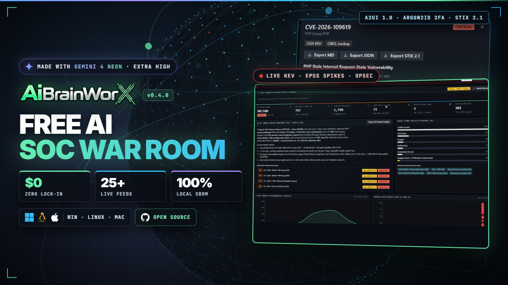
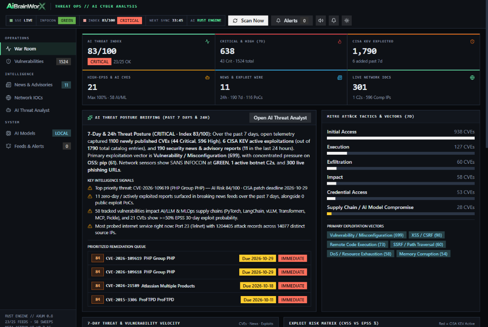
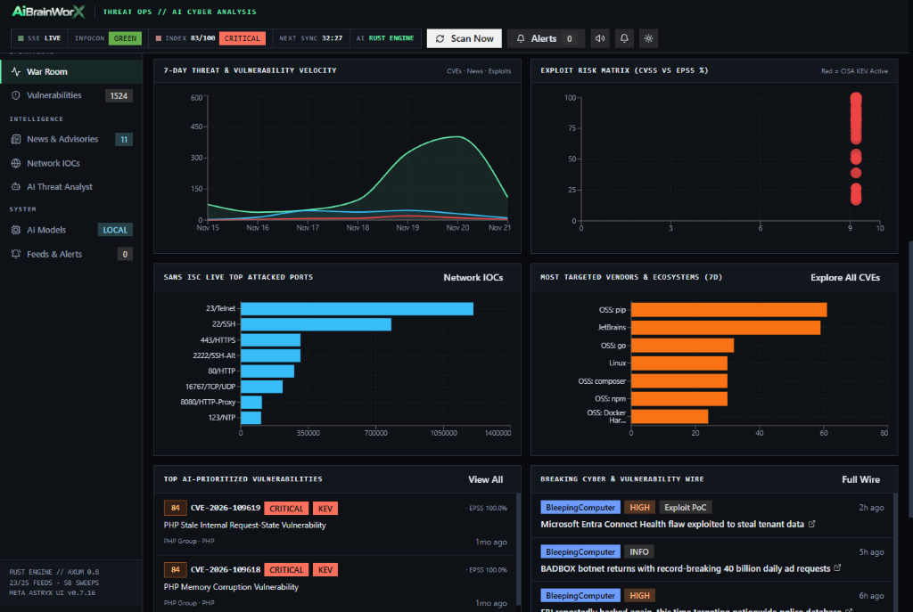
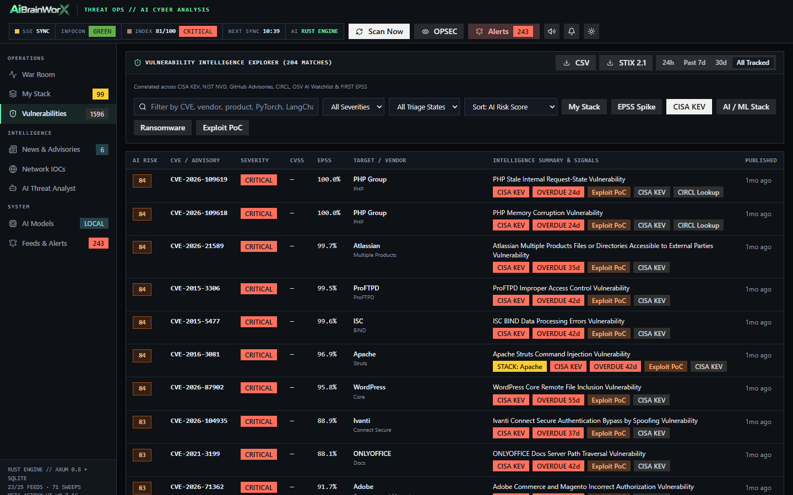
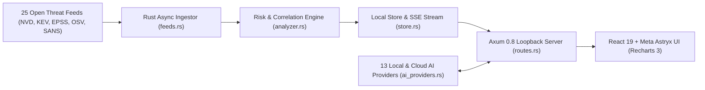

# AiBrainWorX — AI CyberSecurity Threat Analysis Board

[](https://youtu.be/5HoKsq8y_2s)
[](LICENSE)

**An open-source (MIT), local-first Security Operations Center (SOC) & threat-intelligence correlation dashboard built with Rust and React 19.**

[](https://youtu.be/5HoKsq8y_2s)

> **▶ [Watch the Launch Video & Live App Walkthrough on YouTube](https://youtu.be/5HoKsq8y_2s)**

---

## Introduction

AiBrainWorX CyberSecurity Threat Analysis Board was created in response to recent high-velocity cybersecurity headlines — widespread edge and perimeter zero-days, escalating ransomware campaigns, rapid CISA KEV additions, and an emerging wave of vulnerabilities targeting AI/LLM infrastructure (`PyTorch`, `LangChain`, `vLLM`, `LiteLLM`, `Gradio`, `Ray`, `MCP` servers, and unsafe model serialization). Security engineers, developers, and researchers often have to piece together fragmented advisories across NVD, KEV, EPSS, GitHub, Exploit-DB, IOC blocklists, and breaking security wires just to answer one question: *what matters right now, and how exposed is our stack?*

We built this board to consolidate those public intelligence streams into one crisp, zero-lock-in workspace that runs completely locally on **macOS, Linux, and Windows** — with a zero-dependency Rust risk-scoring and correlation engine out of the box, plus optional bring-your-own local LLM (`Ollama`, `LM Studio`, `llama.cpp`, `vLLM`) or cloud AI provider support. See the live dashboard, deep AI triage, and IOC checker in action in the **[YouTube launch video](https://youtu.be/5HoKsq8y_2s)**. It is released as **open source under the [MIT License](LICENSE)** so any team or defender can audit, extend, and self-host it freely.

---

## What It Is (and What It Is Not)

### What It Is
- **A Local Threat Intelligence Aggregator & Correlation Console:** Collects and normalizes public vulnerability feeds, exploit prediction scores (`EPSS`), `CISA KEV` active-exploitation mandates, AI/ML supply-chain advisories, network sensor telemetry, and security news wires in one place.
- **An Explainable Risk Prioritization & Triage Aid:** Computes transparent 0–100 composite risk scores, maps inferred MITRE ATT&CK tactics, tracks hourly Watchlist alerts via real-time Server-Sent Events (`SSE`), and supports on-demand AI-assisted triage using local or cloud models.
- **Cross-Platform & Single-User Workstation Friendly:** Compiles to a fast native Rust binary serving a React 19 + Meta Astryx UI frontend cleanly on **macOS, Linux, and Windows**.

### What It Is Not
- **Not an EDR, Firewall, SIEM, or Auto-Patcher:** It does not install agents on endpoints, inspect your internal packet traffic, block IPs on your network, or modify/patch software automatically.
- **Not an Active Scanner or Exploitation Tool:** It does not port-scan targets, probe infrastructure, verify vulnerabilities against live hosts, or execute exploits.
- **Not a Multi-Tenant or Direct Internet-Facing SaaS App:** It binds strictly to `127.0.0.1` with no built-in user authentication and should **not** be exposed directly to a public network without an authenticating TLS reverse proxy.
- **Not Infallible Security Advice:** Heuristic scores and AI-generated summaries (especially LLM completions) can miss context or hallucinate details — always validate findings and remediation actions against primary vendor advisories (`NVD`, `CISA`, `GHSA`) before making production changes.

---

## Responsible Use & Legal Notice

- **Defensive & Authorized Research Only:** AiBrainWorX CyberSecurity Threat Analysis Board is intended strictly for defensive security monitoring, vulnerability triage, awareness, and authorized security research.
- **Respect Upstream Public Data Providers:** This dashboard aggregates volunteer and government-operated public feeds (CISA, NIST NVD, FIRST, SANS ISC, abuse.ch, OpenPhish, Emerging Threats, OSV, CIRCL, GitHub, and security news outlets). Avoid lowering the polling interval aggressively or running automated scraping loops against community endpoints; the default **1-hour (`3600s`)** sweep interval is designed to stay respectful of public rate limits.
- **Handle Live IOCs Carefully:** The Network IOCs and News views surface real malicious C2 IPs, compromised hosts, and live phishing URLs reported by upstream threat feeds. Inspect links cautiously in isolated analysis environments.
- **No Warranty:** Provided `"AS IS"` under the [MIT License](LICENSE) without warranty of any kind. Users remain responsible for operational security decisions and compliance with applicable laws and organizational policies.

---

## Installation & Running (macOS, Linux, Windows)

### Common Prerequisites
- **Git**
- **Rust toolchain** (`1.80+` recommended, via [rustup.rs](https://rustup.rs/))
- **Node.js `20+` & npm** (`React 19` + `Vite` build)

> Local inference (`Built-in Rust Engine`, `Ollama`, `LM Studio`, `llama.cpp`) works completely offline for AI analysis with zero cloud API keys required.

---

### macOS (Apple Silicon & Intel)

1. Install Xcode Command Line Tools, Homebrew dependencies, and Rust if not already installed:
   ```bash
   xcode-select --install || true
   brew install node
   curl --proto '=https' --tlsv1.2 -sSf https://sh.rustup.rs | sh
   source "$HOME/.cargo/env"
   ```
2. Clone and start the board:
   ```bash
   git clone https://github.com/AiBrainWorXdotCom/aibrainworx-ai-threat-board.git
   cd aibrainworx-ai-threat-board
   chmod +x start.sh
   ./start.sh
   ```
3. Open **http://127.0.0.1:8080** in your browser.

---

### Linux (Ubuntu/Debian, Fedora/RHEL, Arch)

The Rust HTTP client (`reqwest`) uses your system TLS stack (`OpenSSL` + `pkg-config`), so install those build headers first:

- **Ubuntu / Debian:**
  ```bash
  sudo apt-get update
  sudo apt-get install -y build-essential pkg-config libssl-dev curl git
  ```
- **Fedora / RHEL / Rocky:**
  ```bash
  sudo dnf install -y gcc pkg-config openssl-devel curl git
  ```
- **Arch Linux:**
  ```bash
  sudo pacman -S --needed base-devel pkgconf openssl curl git
  ```

Then install Rust & Node.js `20+` (via `rustup` and your distro/NodeSource/nvm), clone, and launch:

```bash
curl --proto '=https' --tlsv1.2 -sSf https://sh.rustup.rs | sh
source "$HOME/.cargo/env"

git clone https://github.com/AiBrainWorXdotCom/aibrainworx-ai-threat-board.git
cd aibrainworx-ai-threat-board
chmod +x start.sh
./start.sh
```

Open **http://127.0.0.1:8080** in your browser.

---

### Windows (PowerShell)

1. Ensure **Node.js `20+`**, **Rust** ([rustup.rs](https://rustup.rs/)), and **Visual Studio C++ Build Tools** (Desktop development with C++ workload) are installed.
2. Clone and start:
   ```powershell
   git clone https://github.com/AiBrainWorXdotCom/aibrainworx-ai-threat-board.git
   cd aibrainworx-ai-threat-board
   .\start.ps1
   ```
3. Open **http://127.0.0.1:8080** in your browser.

---

### Custom Port, Rebuilds & Manual Startup

- **Force a full rebuild** after pulling updates:
  - macOS / Linux: `./start.sh --rebuild`
  - Windows: `.\start.ps1 -Rebuild`
- **Custom port** (default `8080`):
  - macOS / Linux: `PORT=9090 ./start.sh`
  - Windows: `$env:PORT = "9090"; .\start.ps1`
- **Manual build steps** (all platforms):
  ```bash
  cd frontend && npm ci && npm run build && cd ..
  cd backend && cargo build --release && cd ..
  ```
  Then run `./backend/target/release/aibrainworx-threat-board` (or `.\backend\target\release\aibrainworx-threat-board.exe` on Windows) from the repository root.

---

## Features

1. **Open Public Cybersecurity Feeds (Zero API Keys Required):**
   - **Vulnerability & Exploit Databases:** CISA KEV (Known Exploited Vulnerabilities), NIST NVD CVE 2.0 (7-Day window), GitHub Security Advisories, CIRCL Vulnerability Lookup, Google OSV.dev AI/ML Supply-Chain Watchlist (`langchain`, `torch`, `transformers`, `vllm`, `litellm`, `gradio`, `ray`, `mlflow`, `openai`, `mcp`, `picklescan`), FIRST.org EPSS (global top + CVE batch scoring).
   - **Network & IOC Telemetry:** SANS ISC INFOCON, SANS ISC Top Attacked Ports, SANS ISC Top Attacking IPs, abuse.ch Feodo Tracker Botnet C2s, OpenPhish Live Phishing URLs, Emerging Threats Compromised IPs.
   - **Breaking Security News, Advisories & PoCs:** CISA All Advisories, CISA ICS Advisories, BleepingComputer, The Hacker News, Krebs on Security, SecurityWeek, Dark Reading, Exploit-DB PoCs, SANS ISC Handler Diary, Google Project Zero, Microsoft MSRC Updates, Hacker News Security Wire (Algolia).

2. **Hourly Background Ingestion & Real-Time Alerts:**
   - Runs an immediate concurrent sweep on startup and repeats every **3600 seconds (1 hour)** (configurable `60s`–`86400s` in Rules, or triggered manually with **Scan Now**).
   - Evaluates unseen CVEs and vulnerability news against configurable watchlist rules and pushes alerts instantaneously over **SSE (`/api/events`)** to the dashboard banner, toast stack, audio chime, and optional browser desktop notifications.

3. **Universal AI Provider & Local Model Support (13 Providers):**
   - **Local Inference (Zero Cloud):** **Built-in Rust Engine** (instant deterministic threat graph), **Ollama** (`/api/tags` live model discovery & `/api/chat`), **LM Studio**, and **llama.cpp / vLLM / SGLang / LocalAI**.
   - **Cloud & Custom APIs:** **OpenAI**, **Anthropic Claude**, **Google Gemini**, **OpenRouter**, **Groq**, **DeepSeek**, **Mistral AI**, **xAI Grok**, and **Custom OpenAI-Compatible** endpoints.
   - Includes **Test Connection**, live model discovery, per-CVE **Deep AI Triage** in the Investigation Drawer, and automatic fallback to the Built-in Rust Engine if an endpoint is unreachable.

---

## Screenshots & Feature Walkthrough

### 1. SOC War Room Overview
Real-time command strip (`SSE Live`, `SANS INFOCON`, `AI Threat Index`, countdown timer), 6-metric telemetry grid, automated 7-day executive posture briefing, MITRE ATT&CK tactic breakdown, and prioritized remediation queue.



### 2. Multi-Feed Threat Analytics
Correlated 2x2 Recharts analytics tracking 7-day CVE/news/exploit velocity, CVSS vs. EPSS exploitation risk with CISA KEV highlights, SANS ISC live attacked ports, and most targeted vendors and OSS ecosystems.



### 3. Vulnerability Investigation Drawer & Deep AI Triage
Slide-over dossier panel inspecting CISA KEV mandates, CVSS/EPSS metrics, explainable AI risk factor weights, correlated news, and on-demand Markdown **Deep AI Triage** generated by your active local or cloud model.


### 4. Vulnerability Intelligence Explorer
Searchable, sortable CVE and OSV explorer filtering across `24h`, `7d`, `30d`, and all tracked items by severity, CISA KEV status, AI/ML stack impact, ransomware linkage, and public exploit availability.



### 5. Cybersecurity News, Advisories & Exploit Wire
Aggregated multi-source feed cards from CISA Advisories, BleepingComputer, The Hacker News, SecurityWeek, Dark Reading, Exploit-DB, and Hacker News with clickable extracted CVE chips and posture triage scores.


### 6. Network IOCs & Live Indicator Lookup
Instant IPv4, hostname, and phishing domain verifier cross-checking SANS ISC top attackers, abuse.ch Feodo botnet C2s, OpenPhish active campaigns, Emerging Threats compromised hosts, and FIRST.org top EPSS probabilities.


### 7. AI Threat Analyst Console
Interactive natural-language threat hunting console correlating live CVEs, CISA KEVs, exploit PoCs, and network sensors with clickable cited CVE drilldowns.


### 8. Universal AI Provider & Local Model Hub (13 Providers)
Unified configuration hub supporting local engines (Built-in Rust Engine, Ollama live discovery, LM Studio, llama.cpp/vLLM) and cloud APIs (OpenAI, Anthropic Claude, Google Gemini, OpenRouter, Groq, DeepSeek, Mistral, xAI, Custom OpenAI-Compatible) with connection testing and session-only API keys.


### 9. Real-Time Alerts, Hourly Watchdog & Feed Health Matrix
Configurable severity/keyword/KEV alerting rules, live SSE test simulation, acknowledge controls, and per-feed HTTP status, latency, and record telemetry across all 25 public sources.


---

## How It Was Made

AiBrainWorX AI Threat Board was coded with **Gemini 4 Neon Extra High** in **Orchestrator Mode with Hydrogen** and engineered to feel like a single-binary desktop SOC tool — fast to boot, transparent in its risk math, and completely free of Docker stacks, external databases, or cloud lock-in.



### Core Architecture & Stack
- **AI-Assisted Engineering:** Built end-to-end with **Gemini 4 Neon Extra High** in **Orchestrator Mode with Hydrogen**, spanning the async Rust backend, React 19 + Meta Astryx UI, loopback security hardening, macOS/Linux/Windows launchers, and programmatic launch video production.
- **Pure Rust Backend (`backend/`):** Built with Rust (`edition 2021`), `axum 0.8`, `tokio`, `reqwest 0.12`, `feed-rs 2`, `serde`, and `tower-http 0.6` (with gzip compression and static SPA hosting).
  - **Concurrent Feed Ingestion (`backend/src/feeds.rs`):** Polls 25 public JSON APIs, Atom/RSS feeds, plain-text IOC lists, and Google OSV AI/ML batch queries asynchronously on startup and every hour, recording per-feed HTTP status, latency, and record counts.
  - **Deterministic Correlation & Scoring Engine (`backend/src/analyzer.rs`):** Computes explainable 0–100 composite risk scores from advisory severity, FIRST EPSS 30-day exploitation probability, CISA KEV active-exploitation status, public PoCs, and AI/ML supply-chain exposure — plus MITRE ATT&CK tactic inference and automated 7-day executive posture briefings with zero external LLM required.
  - **Universal AI Provider Adapter (`backend/src/ai_providers.rs`):** Connects 13 local and cloud model backends (`Built-in Rust Engine`, `Ollama`, `LM Studio`, `llama.cpp / vLLM`, `OpenAI`, `Anthropic Claude`, `Google Gemini`, `OpenRouter`, `Groq`, `DeepSeek`, `Mistral`, `xAI`, and `Custom OpenAI-Compatible`) with live model discovery, connection testing, and automatic fallback to the local Rust engine.
  - **Local Persistence, Real-Time SSE & Hardening (`backend/src/store.rs`, `routes.rs`, `main.rs`):** Persists normalized telemetry locally to `data/threat_store.json`, streams instant watchlist alerts over Server-Sent Events (`tokio-stream` on `/api/events`), and enforces loopback-only `127.0.0.1` binding, `Host`/`Origin` validation, CSP headers, and memory-only API keys.
- **React 19 + Meta Astryx Frontend (`frontend/`):** Built with `React 19.1`, `TypeScript 5.8`, `Vite 6`, Meta's `@astryxdesign/core` (`0.7.16`) + `@stylexjs/stylex`, `Recharts 3`, and `lucide-react`.
  - Styled in `frontend/src/index.css` with a high-contrast obsidian SOC theme and sharp `0px` square geometry across modular views (`OverviewView`, `VulnerabilitiesView`, `NewsIntelView`, `NetworkIocView`, `AiAnalystView`, `AiModelsView`, `FeedsAndAlertsView`, `InvestigationDrawer`, and `TopCommandBar`).
- **Zero-Dependency Local Packaging:** `Vite` compiles the frontend into `frontend/dist/`, which the native Rust binary serves directly on `http://127.0.0.1:8080`. Cross-platform launcher scripts (`start.sh` for macOS/Linux and `start.ps1` for Windows) detect dependencies, build release artifacts on first run, and launch the server in one command.
- **Launch Video & Demo Production:** The [YouTube launch video](https://youtu.be/5HoKsq8y_2s) and thumbnail were produced programmatically by capturing live sessions of the running dashboard via headless Chrome/Puppeteer, composing beat-synced animations and HUD overlays with [HyperFrames](https://github.com/heygen-com/hyperframes), and rendering to 1080p H.264/AAC via FFmpeg.

---

## Security & API Key Hygiene

- **Localhost Only by Default:** Binds strictly to `127.0.0.1:8080` (`PORT` env var supported), enforces loopback-only `Host` and `Origin` checks against DNS rebinding and cross-site requests, and attaches strict CSP (`frame-ancestors 'none'`) and browser hardening headers. See [SECURITY.md](SECURITY.md) for full details.
- **Recommended API Key Configuration (Environment Variables):**
  Export your provider key in the shell before launching the server so credentials never touch disk in `data/threat_store.json`:
  - Supported variables: `OPENAI_API_KEY`, `ANTHROPIC_API_KEY`, `GEMINI_API_KEY`, `OPENROUTER_API_KEY`, `GROQ_API_KEY`, `DEEPSEEK_API_KEY`, `MISTRAL_API_KEY`, `XAI_API_KEY`, `CUSTOM_AI_API_KEY`.
  - macOS / Linux (`bash` / `zsh`):
    ```bash
    export OPENAI_API_KEY="your-key-here"
    ./start.sh
    ```
  - Windows (`PowerShell`):
    ```powershell
    $env:OPENAI_API_KEY = "your-key-here"
    .\start.ps1
    ```
- **UI-Entered Keys:** Any key entered directly in the **AI Models** view is kept **in memory only** for the active session and never serialized to `data/threat_store.json`.
- **Zero-Key Local Models:** Install [Ollama](https://ollama.com/) (`ollama serve && ollama pull qwen2.5:14b`) or **LM Studio** locally, then select it inside **AI Models** — no cloud API key needed.

## License

Released as open source under the [MIT License](LICENSE).
